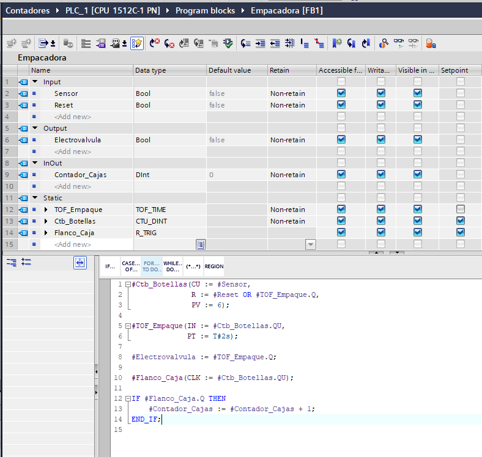
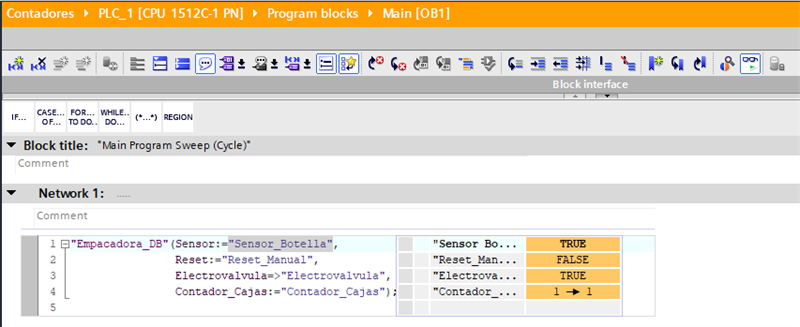

# P1 — Empacadora de botellas (S7-1500 · CPU 1512C-1 PN · TIA Portal V19)

Proyecto de aprendizaje de automatización industrial: empaque de botellas por lotes de 6, con conteo, temporización de la electroválvula y totalizador de cajas.

El objetivo del proyecto es practicar el ciclo completo **sensor → PLC → actuador**, no entregar una máquina real. La lógica está escrita en SCL y probada en PLCSIM.

## Proceso

1. Un sensor inductivo detecta cada botella que pasa por la compuerta.
2. Al llegar a 6 botellas, la compuerta se cierra con una electroválvula durante 2 s.
3. Mientras la válvula está abierta, la banda se detiene y el conteo queda bloqueado.
4. Al terminar el sellado, el contador de botellas se reinicia y el totalizador de cajas suma 1.
5. El pulsador de reset reinicia el lote en cualquier momento.

## Variables

| Tag | Dirección | Tipo | Descripción |
|---|---|---|---|
| `Sensor_Botella` | `%I0.0` | Bool | Sensor inductivo, 1 botella por pulso |
| `Reset_Manual` | `%I0.1` | Bool | Pulsador de reset del lote |
| `Electrovalvula` | `%Q0.0` | Bool | Bobina de la compuerta (`-YV1`) |
| `Contador_Cajas` | `%MD0` | DInt | Totalizador de cajas completadas |

> Durante las pruebas en PLCSIM las entradas se mueven a `%M10.0` / `%M10.1`: la imagen de proceso de `%I` se reescribe en cada ciclo y no se puede forzar a mano.

## Código

`src/FB_Empacadora.scl` — exportado desde TIA Portal con *Generate source from block*.

```scl
#Ctb_Botellas(CU := #Sensor,
              R  := #Reset OR #Tof_Empaque.Q,
              PV := 6);

#Tof_Empaque(IN := #Ctb_Botellas.QU,
             PT := T#2s);

#Electrovalvula := #Tof_Empaque.Q;

#Flanco_Caja(CLK := #Ctb_Botellas.QU);

IF #Flanco_Caja.Q THEN
    #Contador_Cajas := #Contador_Cajas + 1;
END_IF;
```

Llamada desde `OB1` (en LAD; los bloques LAD no se pueden exportar como fuente, así que queda aquí como texto):

```scl
"Empacadora_DB"(Sensor := "Sensor_Botella",
                Reset := "Reset_Manual",
                Electrovalvula => "Electrovalvula",
                Contador_Cajas := "Contador_Cajas");
```

## Decisiones de diseño

- **`TOF` en lugar de `TON`.** El contador entrega `QU` durante un solo ciclo. Un `TON` necesitaría la señal sostenida 2 s y nunca llegaría a `PT`; el `TOF` mantiene la válvula los 2 s a partir de ese pulso, sin memorias intermedias.
- **`R := #Reset OR #Tof_Empaque.Q`.** El reset no puede depender solo del pulsador: sin él, `CV` no bajaría de 6, `QU` quedaría fijo en 1 y la válvula no cerraría nunca. Además, mantener `R` activo durante el sellado bloquea el conteo mientras la caja está en proceso.
- **Reset por el pin `Q` del `TOF`, no por la salida `#Electrovalvula`.** La salida física puede tener otros escritores (HMI, modo manual); usar el pin de la instancia garantiza un único dueño.
- **`R_TRIG` en el conteo de cajas.** Hoy es redundante porque `QU` ya dura un ciclo, pero desacopla la lógica del diseño del reset: si el reset se retrasa, sin detector de flanco se contaría una caja por ciclo de scan.
- **Suma directa en vez de `CTU` para las cajas.** `CTU` sirve para contar hacia una meta (`PV`); para un totalizador no hay meta, y con `PV := 0` la salida `QU` queda inútil en 1.

## Capturas





## Cómo probarlo

1. Abrir el proyecto en TIA Portal V19 y compilar.
2. Iniciar simulación (PLCSIM).
3. Poner `%M10.0` a 1 y a 0 seis veces.
4. Verificar: `%Q0.0` sube a 1, se mantiene 2 s y cae solo; `%MD0` sube a 1.
5. Pulsar `%M10.1` a mitad de un lote: el conteo de botellas vuelve a 0 y la válvula no abre.

## Pendientes

- [ ] Devolver `Sensor_Botella` y `Reset_Manual` a `%I` antes de publicar
- [ ] Decidir retentividad de `%MD0` (propiedades de la CPU → *Retentive memory*)
- [ ] Pantalla HMI WinCC con contador de cajas y mando manual de la válvula
- [ ] Capturas del programa y de la simulación en `docs/`
